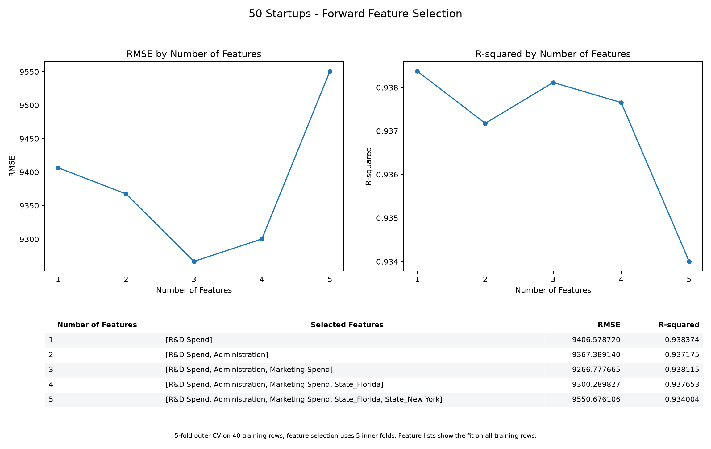

# 50 Startups: Feature Selection Results

Forward Sequential Feature Selection was used to compare linear regression
models containing one through five encoded input features.

| Number of Features | Selected Features | RMSE | R-squared |
| --- | --- | ---: | ---: |
| 1 | R&D Spend | 9406.578720 | 0.938374 |
| 2 | R&D Spend, Administration | 9367.389140 | 0.937175 |
| 3 | R&D Spend, Administration, Marketing Spend | 9266.777665 | 0.938115 |
| 4 | R&D Spend, Administration, Marketing Spend, State_Florida | 9300.289827 | 0.937653 |
| 5 | R&D Spend, Administration, Marketing Spend, State_Florida, State_New York | 9550.676106 | 0.934004 |

The dataset contains 50 observations. The existing 80/20 split with
random_state=42 was preserved. Metrics are means from five outer folds on the
40 training observations. Feature selection uses five inner folds within each
outer training portion. The 10 test observations remain excluded.

The table's selected feature lists come from fitting SFS on all 40 training
observations. Independently selected subsets inside the outer folds may differ.
R-squared is the mean of the five fold scores, not a pooled R-squared.

The three-feature model has the lowest mean RMSE in this feature-count
comparison. Adding the state indicators increases mean RMSE here. One feature
has the highest mean fold R-squared; averaging R-squared and RMSE can yield
different rankings because fold R-squared uses each fold's target variance.
The experiment selects feature counts by RMSE.

These small differences on a small dataset do not establish a decisive
advantage for a particular feature count. The separate six-method comparison
continues to select ElasticNetCV/LassoCV as its tied winners.

The values were calculated from the actual GitHub dataset using the existing
project configuration. They reproduce the example's format, with independently
calculated numerical results.
